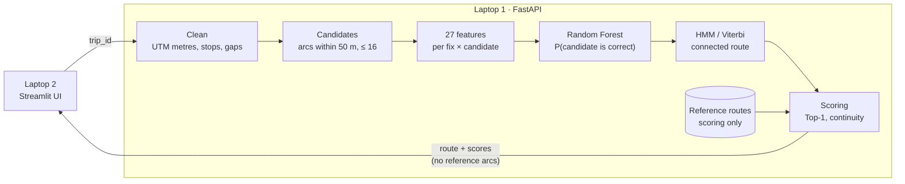

# PathSnap: Distributed Map-Matching & Route Reconstruction

**PES University · UE24CS352A Machine Learning · Hackathon**

PathSnap takes noisy GPS traces and reconstructs the road route a vehicle actually drove. For every GPS fix it
predicts the directed road segment (arc) the vehicle was on. Then an HMM/Viterbi decoder joins those predictions
into a connected route. The system runs on two laptops: a FastAPI backend with the model, and a Streamlit UI for
the evaluator.

📄 **Technical report:** [`docs/4_Report.pdf`](docs/4_Report.pdf)

## Team

| Name | SRN |
|---|---|
| Harsha K | PES1UG24CS666 |
| Arjun Kangal | PES1UG24CS922 |
| Santosh N | PES1UG24CS615 |
| Sanskar G | PES1UG24CS614 |

## Results at a glance

Final pipeline: **tuned Random Forest + HMM/Viterbi** (frozen in [`models/hmm_config.json`](models/hmm_config.json)).
Metric: observation-level Top-1 accuracy, the share of GPS fixes matched to the correct road segment.

| Partition | Classifier only | Classifier + HMM |
|---|---|---|
| Train, nested 5-fold CV (80 trips) | 0.8894 ± 0.0365 | **0.9423** ± 0.0252 |
| Student test (10 trips) | 0.8992 | **0.9523** |
| Evaluator test (10 trips, scored once) | 0.8688 | **0.9616** |

The HMM adds about 5–9 points, mostly by fixing fixes matched to the wrong direction of a two-way street.
A full trip takes 0.1–0.6 s through the API.

## How it works



1. **Cleaning:** project each trip to its UTM zone, split at GPS gaps over 120 s, detect stops, and flag
   off-network fixes and speed glitches. No rows are deleted, because every fix needs a prediction.
2. **Candidates:** directed arcs within 50 m of each fix, at most 16, with geometric duplicates merged.
3. **Features:** 27 label-free features covering distance, rank, heading vs. arc bearing, consistency over ±5 fixes,
   speed, stop flags and topology.
4. **Classifier:** a tuned Random Forest scores each (fix, candidate) pair.
5. **HMM/Viterbi:** hidden states are the candidates of each fix. Emission is the classifier probability. Transition
   compares the driving distance along directed arcs with the GPS distance, with U-turn, stop and speed penalties.
6. **API + UI:** the UI sends only a trip id. The API predicts, then scores against the reference route on the
   server, and returns the route and the numbers, never the reference arcs.

## Repository layout

```
api/main.py                  FastAPI backend (laptop 1): /health, /trips, /predict
ui/app.py                    Streamlit evaluator UI (laptop 2)
ui/mock_api.py               mock API with the same contract, for testing the UI
ui/requirements.txt          packages needed on laptop 2 only
src/pathsnap/
  data_io.py                 loaders for .track / .nodes / .arcs / .route
  geo.py                     per-trip UTM projection, haversine
  eda_metrics.py             per-trip EDA statistics and anomaly flags
  cleaning.py                cleaning: metres, gap segments, stops, quality flags
  labels.py                  per-fix reference arc (order-respecting DP alignment)
  candidates.py              candidate arcs per fix
  features.py                27 features per (fix, candidate)
  training.py                the 5 models, cross-validation, metrics
  tuning.py                  Optuna search spaces and objective
  hmm.py                     HMM + Viterbi, predict_trip()
  maps.py                    Folium map of one trip
  inference.py               one-trip pipeline used by the API
scripts/run_eda.py           dataset exploration -> outputs/eda/
scripts/run_cleaning.py      cleaning -> data/processed/ (git-ignored)
notebooks/03 … 08            features, training, tuning (LightGBM, RF), HMM, evaluator run
models/                      trained models + hmm_config.json (final pipeline)
outputs/                     every table, figure, map and report behind the numbers above
docs/                        report (PDF, Word), API contract, data-quality notes
Student folder/              raw dataset: train/ (80 trips), student_test/ (10 trips)
PathSnap_student_materials/  hackathon brief
```

## Setup

Python 3.13 or 3.14.

```bash
# macOS / Linux
python3 -m venv .venv
.venv/bin/python -m pip install -r requirements.txt
brew install libomp            # macOS only: LightGBM needs OpenMP

# Windows (PowerShell)
py -3.13 -m venv .venv
.venv\Scripts\python -m pip install -r requirements.txt
```

The commands below use the macOS path `.venv/bin/python`. On Windows, use `.venv\Scripts\python`.

## Running the demo (two laptops)

**Laptop 1 (API).** Copy the `evaluator_test/` folder into the repo root first. It is git-ignored and never committed.

```bash
# macOS / Linux
PATHSNAP_TRIPS_DIR=evaluator_test .venv/bin/python -m uvicorn api.main:app --host 0.0.0.0 --port 8000
```
```powershell
# Windows (PowerShell)
$env:PATHSNAP_TRIPS_DIR="evaluator_test"
.venv\Scripts\python -m uvicorn api.main:app --host 0.0.0.0 --port 8000
```

The first log line should read `classifier=RandomForest_tuned | decoder=HMM-Viterbi | trips=10 from evaluator_test`.
Every request is logged with step timings and scores. Without `PATHSNAP_TRIPS_DIR` the API serves the student_test trips.

**Laptop 2 (UI).** Only the UI packages are needed:

```bash
python3 -m venv .venv && .venv/bin/python -m pip install -r ui/requirements.txt
PATHSNAP_API_URL=http://<laptop-1-ip>:8000 .venv/bin/streamlit run ui/app.py
```

Open http://localhost:8501, pick a trip in the sidebar and press **Run prediction**. The page shows the scores
(Top-1 with HMM, classifier-only Top-1, route continuity) and a map of the raw GPS and the predicted route.

**Network checklist**
- Start the API with `--host 0.0.0.0`. Otherwise it only accepts connections from laptop 1 itself.
- Allow inbound TCP 8000 on laptop 1. On Windows (Admin PowerShell):
  `New-NetFirewallRule -DisplayName "PathSnap API 8000" -Direction Inbound -Protocol TCP -LocalPort 8000 -Action Allow -Profile Any`
- Put both laptops on the same network. Campus Wi-Fi may block laptop-to-laptop traffic; a hotspot from laptop 1 works.
- Check from laptop 2: `curl http://<laptop-1-ip>:8000/health`.

The request and response format is fixed in [`docs/API_CONTRACT.md`](docs/API_CONTRACT.md). To build or test the UI
without the model, run `python -m uvicorn ui.mock_api:app --port 8000`: a nearest-road baseline on student_test, shown
with a "MOCK API" banner.

## Reproducing the results

Run the steps in order. Every step is deterministic (seed 42) and writes its evidence to `outputs/`.
The notebooks use the kernel "PathSnap (.venv)":
`python -m ipykernel install --user --name pathsnap --display-name "PathSnap (.venv)"`.

| Step | Run | Time (CPU) | Outputs |
|---|---|---|---|
| 1. Dataset exploration | `scripts/run_eda.py` | 3–5 min | [`outputs/eda/EDA_REPORT.md`](outputs/eda/EDA_REPORT.md), tables, figures, Folium maps |
| 2. Cleaning | `scripts/run_cleaning.py` | ~1 min | `data/processed/`, [`outputs/cleaning/CLEANING_REPORT.md`](outputs/cleaning/CLEANING_REPORT.md) |
| 3. Labels, candidates, features | `notebooks/03_features.ipynb` | ~2 min | `data/features/`, [`outputs/features/FEATURES_REPORT.md`](outputs/features/FEATURES_REPORT.md) |
| 4. Train and compare 5 models | `notebooks/04_model_training.ipynb` | ~25 min | [`outputs/models/MODEL_COMPARISON.md`](outputs/models/MODEL_COMPARISON.md), `models/*.joblib` |
| 5. Tune LightGBM | `notebooks/05_bayesian_tuning.ipynb` | ~80 min | [`outputs/tuning/TUNING_REPORT.md`](outputs/tuning/TUNING_REPORT.md), `models/LightGBM_tuned.joblib` |
| 6. Tune Random Forest | `notebooks/06_bayesian_tuning_rf.ipynb` | ~80 min | [`outputs/tuning_rf/TUNING_REPORT_RF.md`](outputs/tuning_rf/TUNING_REPORT_RF.md), `models/RandomForest_tuned.joblib` |
| 7. HMM + Viterbi | `notebooks/07_hmm_viterbi.ipynb` | ~40 min | [`outputs/hmm/HMM_REPORT.md`](outputs/hmm/HMM_REPORT.md), `models/hmm_config.json` |
| 8. Final evaluator run | `notebooks/08_evaluator_test.ipynb` | a few min | [`outputs/evaluator_results/EVALUATOR_TEST_REPORT.md`](outputs/evaluator_results/EVALUATOR_TEST_REPORT.md) |

Raw data is read from `Student folder/` by default; set `PATHSNAP_DATA` to use another folder. Notebook 08 looks for
`evaluator_test/` in the repo root, or wherever `PATHSNAP_EVAL_ROOT` points.

## Details

<details>
<summary><b>Dataset and cleaning</b></summary>

- Each trip has four header-less files. `.track` holds lon, lat, t. `.nodes` holds lon, lat. `.arcs` holds from and
  to node ids. `.route` holds the reference arc ids in driving order. Each trip has **its own** road network.
- **0 malformed rows**, 0 out-of-range coordinates, and timestamps always increase. 96.7% of steps are 1 s, but 30
  trips have gaps over 30 s (the longest is 42.5 h).
- The trips span 25 UTM zones worldwide. Median GPS-to-road distance is 5 m.
- Problems found:
  - parked GPS jitter (trip 54 is parked 79% of the time)
  - speed glitches (151 steps over 70 m/s, all still on the road)
  - imperfect labels: 14 route breaks, 54 U-turns and 322 revisits
- Trips 33 and 54 are excluded from training, because most of their fixes are more than 50 m from their own route.
- Interpretation and decisions: [`docs/DATA_QUALITY_NOTES.md`](docs/DATA_QUALITY_NOTES.md).
</details>

<details>
<summary><b>Labels, candidates and features</b></summary>

- **Labels:** an order-respecting DP alignment of the fixes to the `.route` sequence, which handles U-turns and revisits.
  Used for training and scoring only.
- **Candidates:** radius 50 m and K = 16, chosen by a train-only miss-rate sweep. Train miss rate 0.11%, student-test 0.16%.
- **Features:** 27, listed in `FEATURE_COLS` in [`features.py`](src/pathsnap/features.py). Picking the nearest arc alone
  scores 51–55% Top-1; the heading and window-consistency features carry most of the gain.
</details>

<details>
<summary><b>Models (5 families)</b></summary>

All five are defined in `model_specs()` in [`src/pathsnap/training.py`](src/pathsnap/training.py). Cross-validation is
5-fold GroupKFold by trip.

| # | Model | Family | Code | CV Top-1 (untuned) | Student-test Top-1 |
|---|---|---|---|---|---|
| 1 | Logistic Regression | Linear | [line 69](src/pathsnap/training.py#L69) | 0.8778 | 0.8772 |
| 2 | K-Nearest Neighbours | Instance-based | [line 79](src/pathsnap/training.py#L79) | 0.8733 | 0.8779 |
| 3 | Random Forest | Ensemble (bagging) | [line 91](src/pathsnap/training.py#L91) | **0.8871** | **0.9001** |
| 4 | LightGBM | Boosting | [line 102](src/pathsnap/training.py#L102) | 0.8851 | 0.8943 |
| 5 | MLP | Neural network | [line 113](src/pathsnap/training.py#L113) | 0.8793 | 0.8860 |
</details>

<details>
<summary><b>Bayesian tuning (Optuna TPE)</b></summary>

- **Objective:** mean CV Top-1 on the same 5 folds. Seed 42, with a MedianPruner. Student-test was never used during a search.
- **LightGBM:** 60 trials. CV Top-1 0.8851 → 0.8900. The best settings are a simpler, more regularised model.
- **Random Forest:** 37 trials. CV Top-1 0.8871 → 0.8894.
- **HMM decoder:** 60 trials per classifier, on train out-of-fold probabilities. CV numbers are nested.
- Search spaces: [`tuning.py`](src/pathsnap/tuning.py) and `SEARCH_SPACE` in [`hmm.py`](src/pathsnap/hmm.py).
</details>

<details>
<summary><b>HMM / Viterbi</b></summary>

- **Hidden states:** the candidate arcs of each fix. On average 7–9 per fix, at most 16.
- **Emission:** log max(p, p_floor), plus an optional Gaussian distance term
  ([`log_emission`](src/pathsnap/hmm.py#L239)).
- **Transition:** cost = min(|route − gps| / β, no_path_pen) + U-turn, stop and speed penalties. Route distances
  come from a distance-bounded Dijkstra on directed arcs ([`log_transition`](src/pathsnap/hmm.py#L247)).
- **Gaps and missing candidates:** a new chain starts at gaps over 120 s. A fix with no candidate is carried over.
  A missing path gets a large but finite cost, so decoding never breaks.
- **Ablation:** removing the U-turn penalty costs 4.0 points; the HMM as a whole adds 5.1 points
  (train out-of-fold).
- **Final choice:** Random Forest + HMM, because its nested-CV Top-1 (0.9423) beats LightGBM + HMM (0.9359).
</details>

## Rules followed

- **No leakage.** Splits are by trip. Every choice was made on train cross-validation. The student test was used for
  comparison. The evaluator trips were scored once, by the frozen pipeline.
- **Ground truth stays on laptop 1.** Prediction reads only `.track`, `.nodes` and `.arcs`. The route is used only
  for server-side scoring and never reaches the UI.
- **Every reported number** comes from files in `outputs/`, produced by the scripts and notebooks above.

## Known limitations

- **Imperfect reference labels.** Route breaks and off-network driving make Top-1 a noisy measure. We report it on
  all fixes and on label-reliable fixes.
- **Results vary slightly between computers.** The two directions of a two-way street tie on `dist_rank` and
  `win_mean_rank`, and the tie is broken by spatial-index order. The fix (equal rank for ties in `rank_within()`)
  is identified but not applied.
- **The HMM still breaks about 1 fix for every 5 it corrects**, mostly during stops at junctions.

See section 9 of the [report](docs/4_Report.pdf) for details.
