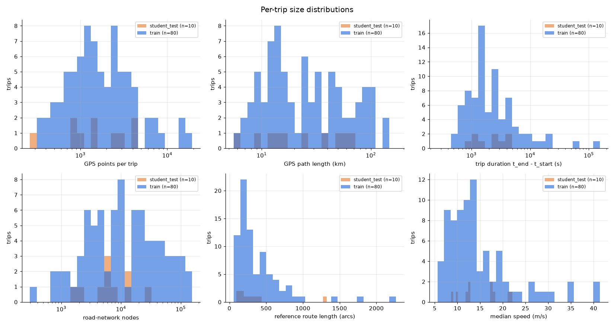
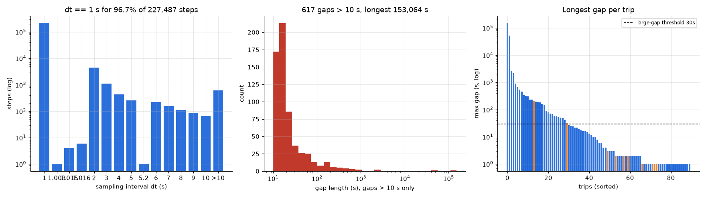
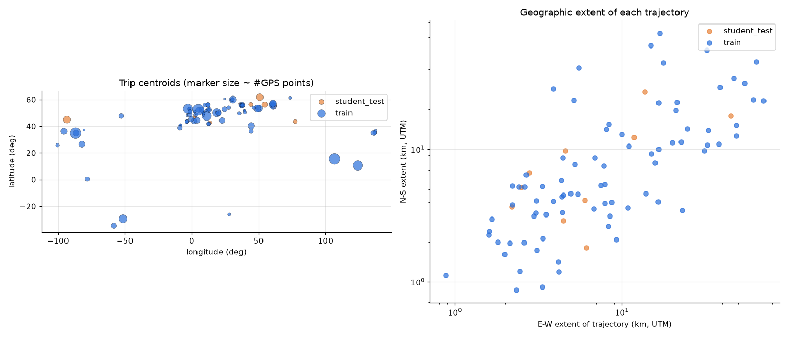
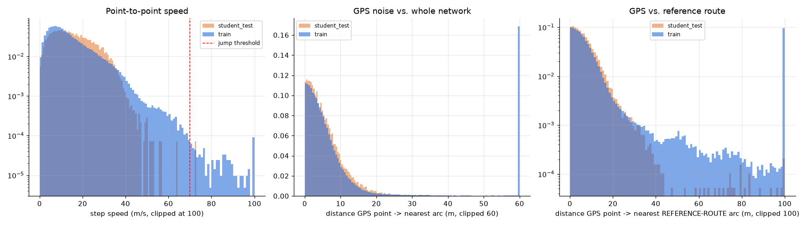
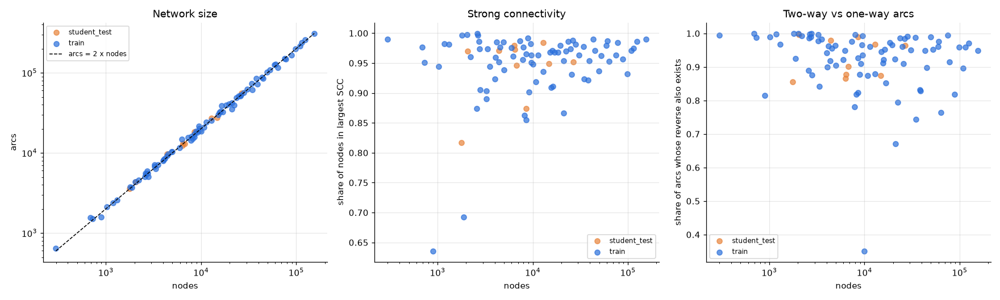
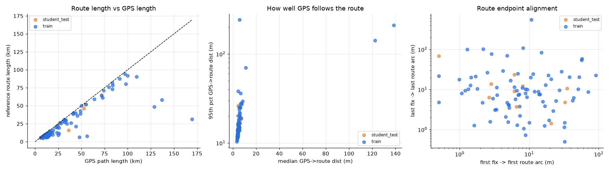
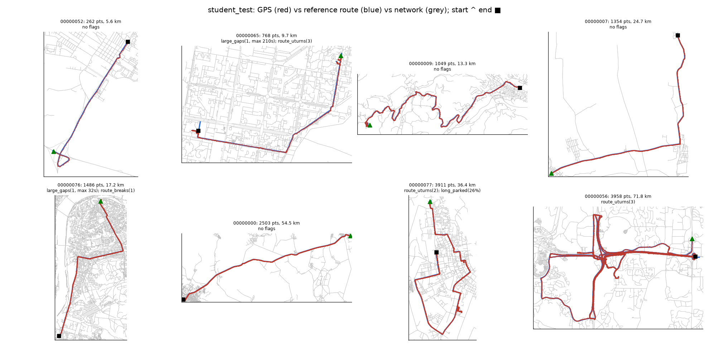
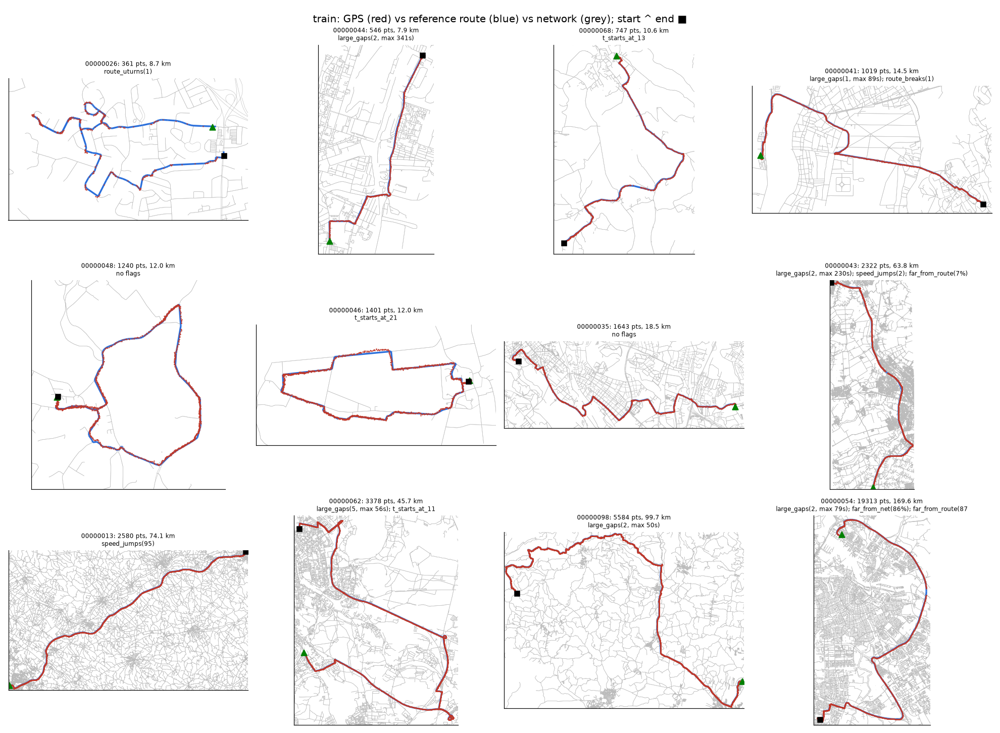
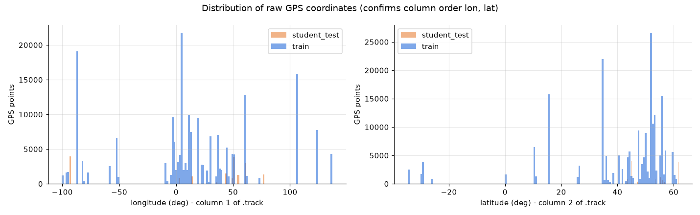

# PathSnap - Dataset Exploration Report (auto-generated)

Generated by `scripts/run_eda.py` on 2026-11-18 10:49. Every number below is recomputed from the raw files on each run; per-trip values are in `tables/trip_summary.csv`. Interpretation and decisions: `docs/DATA_QUALITY_NOTES.md`.

## 1. Inventory

| partition | trips | files_present | gps_points_total | gps_points_median | nodes_total | arcs_total | route_arcs_total | disk_mb |
|---|---|---|---|---|---|---|---|---|
| student_test | 10 | 40 | 19160 | 1420.00 | 90689 | 185041 | 3477 | 4.65 |
| train | 80 | 320 | 208417 | 1529.00 | 1933485 | 3876904 | 31336 | 95.58 |

* Partitions on disk: student_test, train. The evaluator-test partition is not available locally and is never read.
* Every trip folder holds exactly the 4 files `<id>.track/.nodes/.arcs/.route`: True.
* Column counts per file (all rows, all trips): track=['3'], nodes=['2'], arcs=['2'], route=['1'].
* Malformed rows (blank / wrong column count / non-numeric / NaN / inf): 0.
* Inferred schema: `.track` float lon, float lat, float t (s); `.nodes` float lon, float lat; `.arcs` int from_node, int to_node; `.route` int arc_id. No headers anywhere.

## 2. Trajectories

* GPS points per trip: min 262, median 1496, max 19313 (total 227,577).
* Coordinates out of range: lon 0, lat 0, (0,0) points 0. Share of GPS points inside their own network's bbox: min over trips 1.000 -> column order (lon, lat) confirmed.
* Trips span 25 UTM zones: EPSG:32614 (1), EPSG:32615 (2), EPSG:32616 (2), EPSG:32617 (3), EPSG:32622 (1), EPSG:32629 (3), EPSG:32630 (9), EPSG:32631 (7), EPSG:32632 (8), EPSG:32633 (7), EPSG:32634 (5), EPSG:32635 (3), EPSG:32636 (5), EPSG:32637 (10), EPSG:32638 (4), EPSG:32639 (4), EPSG:32640 (2), EPSG:32641 (4), EPSG:32643 (2), EPSG:32648 (1), EPSG:32651 (1), EPSG:32653 (3), EPSG:32721 (1), EPSG:32722 (1), EPSG:32735 (1); lon -100.42..137.24, lat -34.64..61.70.
* Trajectory extent (UTM): median 6.8 km E-W x 5.3 km N-S; GPS path length median 24.0 km, max 169.6 km.
* UTM vs haversine step length: max relative difference 0.55% (sphere-vs-ellipsoid + UTM scale) - negligible vs GPS noise.

### Timestamps and sampling

* Steps with dt == 1 s: 96.68% of 227,487. dt == 2 s: 1.96%. dt > 10 s: 617 steps. dt <= 0 (out of order / duplicate t): 0.
* Non-integer timestamps (beyond 1e-6 float noise): 9659.
* Trips not starting at t = 1: 16 (t_start up to 693 s) -> t is relative, not wall-clock.
* Trips with at least one gap > 30 s: 30; longest gap 153,064 s (42.5 h, trip 00000090).

### Motion / noise

* Step speed: median 11.3 m/s, p99 45.5 m/s, max 181 m/s. Steps faster than 70 m/s: 151 in 11 trips.
* Stationary steps (< 0.5 m/s): 0.3%; exact duplicate consecutive positions: 6. Window test (moved < 30 m over 60 fixes): median 0.7% of a trip is parked; 7 trips are parked > 20 % of the time (max 79%, trip 00000054).
* Distance GPS -> nearest arc of the network: median 5.0 m, p95 81.1 m, p99 96.9 m, max 241 m.
* Distance GPS -> nearest arc of the REFERENCE ROUTE: median 5.6 m, p95 137.7 m, p99 200.4 m, max 570 m.

## 3. Road networks

* Each trip has its own network extract (no two `.nodes` files identical). Nodes per trip: min 299, median 9,305, max 155,003; arcs / nodes median 2.03.
* All arc endpoints are valid node indices: True. Self loops: 24 total; duplicate (from,to) arcs: 1903 total; zero-length arcs: 106; duplicate node coordinates: 92.
* Arcs are DIRECTED. Share with a reverse arc: median 0.95 (min 0.35) -> two-way roads are stored as two arcs, the rest are one-way.
* Arc length: median of per-trip medians 25.1 m; longest arc 9,358 m.
* Isolated nodes (degree 0): 0 total. Weakly connected components per trip: median 19, max 421; largest WCC covers median 98.0% (min 69.3%) of nodes.
* Strongly connected components: median 107 per trip; largest SCC covers median 96.4% (min 63.6%). Dead-end nodes (in>0, out=0): median 6 per trip.

## 4. Reference routes

* Route present for 90/90 trips; all arc ids valid: True. Length: median 272 arcs (14.3 km).
* Route length / GPS path length: median 0.85, range 0.13..0.99.
* Contiguity: 11 trips have >=1 break (arc[i].to != arc[i+1].from), 14 breaks total. Consecutive duplicate arcs: 0. Immediate U-turns: 54. Arcs revisited later in the same route: 322.
* Route arcs inside the network's largest SCC: min share over trips 0.457.
* First GPS fix -> first route arc: median 7.4 m, max 90 m. Last fix -> last arc: median 8.9 m, max 548 m.
* Trips with > 5 % of GPS points more than 50 m from the route: 4.

## 5. Anomalous trips

63 of 90 trips raise at least one flag (thresholds in `src/pathsnap/eda_metrics.py`). Full list: `tables/anomalies.csv`. Trips with >= 2 flags:

| partition | trip_id | n_points | flags |
|---|---|---|---|
| student_test | 00000065 | 768 | large_gaps(1, max 210s); route_uturns(3) |
| student_test | 00000076 | 1486 | large_gaps(1, max 32s); route_breaks(1) |
| student_test | 00000077 | 3911 | route_uturns(2); long_parked(26%) |
| train | 00000002 | 7243 | large_gaps(10, max 160s); far_from_net(7%); route_breaks(1); far_from_route(12%) |
| train | 00000004 | 1064 | large_gaps(2, max 51s); route_uturns(1) |
| train | 00000006 | 1450 | large_gaps(3, max 301s); t_starts_at_693; route_uturns(1) |
| train | 00000008 | 3093 | speed_jumps(1); route_uturns(5) |
| train | 00000011 | 2828 | large_gaps(1, max 909s); route_uturns(1) |
| train | 00000014 | 448 | large_gaps(1, max 72s); t_starts_at_2 |
| train | 00000016 | 1305 | route_uturns(1); long_parked(24%) |
| train | 00000021 | 15783 | large_gaps(2, max 2161s); t_starts_at_2 |
| train | 00000032 | 2464 | large_gaps(1, max 41s); t_starts_at_2; speed_jumps(43) |
| train | 00000033 | 5844 | speed_jumps(1); route_breaks(1); far_from_route(59%); long_parked(79%) |
| train | 00000034 | 3614 | t_starts_at_2; route_uturns(1) |
| train | 00000041 | 1019 | large_gaps(1, max 89s); route_breaks(1) |
| train | 00000042 | 7739 | large_gaps(22, max 670s); route_breaks(1); route_uturns(1) |
| train | 00000043 | 2322 | large_gaps(2, max 230s); speed_jumps(2); far_from_route(7%) |
| train | 00000054 | 19313 | large_gaps(2, max 79s); far_from_net(86%); far_from_route(87%); long_parked(79%) |
| train | 00000062 | 3378 | large_gaps(5, max 56s); t_starts_at_11 |
| train | 00000069 | 2067 | large_gaps(2, max 2658s); route_breaks(1) |
| train | 00000070 | 2076 | large_gaps(1, max 152s); t_starts_at_2; route_uturns(2) |
| train | 00000075 | 1628 | route_breaks(2); route_uturns(9) |
| train | 00000078 | 2909 | large_gaps(2, max 52810s); t_starts_at_3 |
| train | 00000080 | 2510 | large_gaps(2, max 59s); route_breaks(1) |
| train | 00000081 | 3224 | large_gaps(37, max 536s); t_starts_at_3 |
| train | 00000084 | 16031 | large_gaps(4, max 312s); route_uturns(5) |
| train | 00000085 | 1092 | large_gaps(4, max 70s); route_uturns(1) |
| train | 00000088 | 876 | large_gaps(7, max 232s); route_uturns(1) |
| train | 00000089 | 1228 | large_gaps(7, max 193s); route_breaks(1) |
| train | 00000090 | 536 | large_gaps(1, max 153064s); t_starts_at_4; route_uturns(4) |

## 6. Figures and maps

Interactive Folium maps (open in a browser; layers: clipped network, reference route, GPS, gaps):

* [`train_00000095.html`](maps/train_00000095.html) - train/00000095: typical (median #points)
* [`train_00000090.html`](maps/train_00000090.html) - train/00000090: longest gap
* [`train_00000019.html`](maps/train_00000019.html) - train/00000019: most route breaks
* [`train_00000002.html`](maps/train_00000002.html) - train/00000002: worst GPS-to-route fit (p95)
* [`train_00000013.html`](maps/train_00000013.html) - train/00000013: most speed jumps
* [`train_00000026.html`](maps/train_00000026.html) - train/00000026: fewest GPS points
