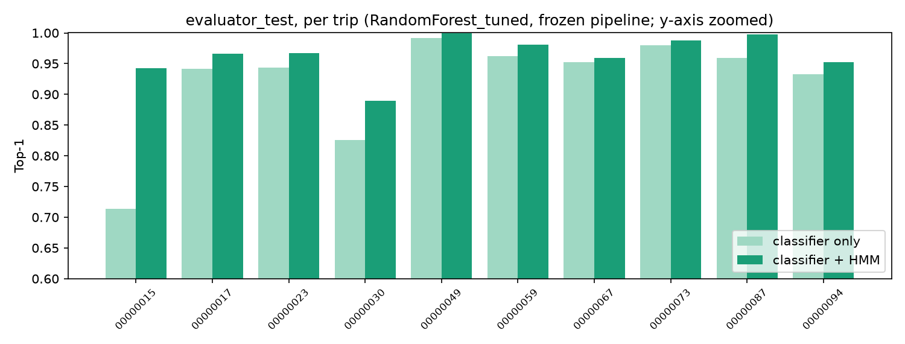

# PathSnap: final run on the evaluator_test trips

Auto-generated by `notebooks/08_evaluator_test.ipynb`. Frozen pipeline: **RandomForest_tuned + HMM** with the decoder from `models/hmm_config.json`. Nothing was chosen or tuned on these trips: every choice was made on train cross-validation before this run. Prediction uses only `.track`, `.nodes` and `.arcs` (`hmm.predict_trip`); `.route` is read afterwards, for scoring only.

**Result:** Top-1 0.9616 with the HMM vs 0.8688 for the classifier alone (pooled over 19,674 labelled fixes of 10 trips).

## Summary

|                                            |   Top-1 pooled |   Top-1 pooled (reliable) |   Top-1 trip average |   worst trip |   best trip |   route continuity (trip average) |   sequence precision |   sequence recall |   sequence F1 |   seconds per trip (mean) |
|:-------------------------------------------|---------------:|--------------------------:|---------------------:|-------------:|------------:|----------------------------------:|---------------------:|------------------:|--------------:|--------------------------:|
| ('RandomForest_tuned', 'classifier only')  |         0.8688 |                    0.869  |               0.9202 |       0.714  |      0.9913 |                            0.9372 |               0.9029 |            0.9733 |        0.9368 |                    0.8711 |
| ('RandomForest_tuned', 'classifier + HMM') |         0.9616 |                    0.9619 |               0.9643 |       0.8899 |      0.9996 |                            0.9661 |               0.9883 |            0.9772 |        0.9827 |                    0.8711 |
| ('LightGBM_tuned', 'classifier only')      |         0.8711 |                    0.8713 |               0.923  |       0.7151 |      0.9947 |                            0.9426 |               0.9081 |            0.974  |        0.9399 |                    0.8897 |
| ('LightGBM_tuned', 'classifier + HMM')     |         0.9617 |                    0.962  |               0.9641 |       0.8899 |      0.9996 |                            0.9655 |               0.9878 |            0.9772 |        0.9824 |                    0.8897 |

## Top-1 per trip

|   trip_id |   ('fixes', '') |   ('LightGBM_tuned', 'classifier + HMM') |   ('LightGBM_tuned', 'classifier only') |   ('RandomForest_tuned', 'classifier + HMM') |   ('RandomForest_tuned', 'classifier only') |
|----------:|----------------:|-----------------------------------------:|----------------------------------------:|---------------------------------------------:|--------------------------------------------:|
|  00000015 |            6854 |                                   0.9418 |                                  0.7151 |                                       0.9428 |                                      0.714  |
|  00000017 |            1346 |                                   0.9673 |                                  0.9428 |                                       0.9658 |                                      0.9413 |
|  00000023 |             458 |                                   0.9629 |                                  0.9432 |                                       0.9672 |                                      0.9432 |
|  00000030 |             654 |                                   0.8899 |                                  0.8394 |                                       0.8899 |                                      0.8257 |
|  00000049 |            2642 |                                   0.9996 |                                  0.9947 |                                       0.9996 |                                      0.9913 |
|  00000059 |            1031 |                                   0.9796 |                                  0.9661 |                                       0.9806 |                                      0.9622 |
|  00000067 |             916 |                                   0.9596 |                                  0.9487 |                                       0.9596 |                                      0.952  |
|  00000073 |            1144 |                                   0.9886 |                                  0.9816 |                                       0.9878 |                                      0.9799 |
|  00000087 |            1399 |                                   0.9964 |                                  0.9621 |                                       0.9971 |                                      0.9593 |
|  00000094 |            3230 |                                   0.9551 |                                  0.9365 |                                       0.9523 |                                      0.9331 |

