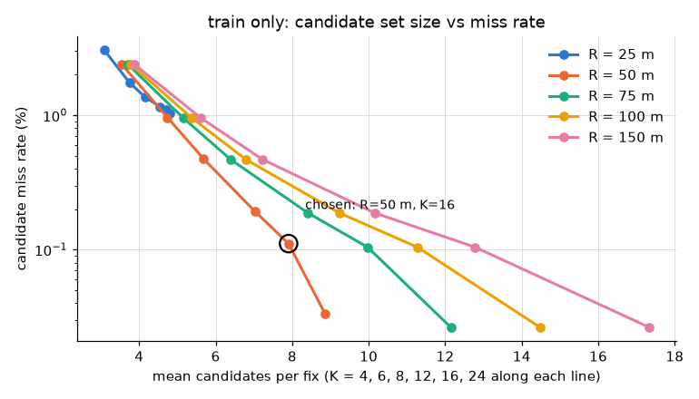
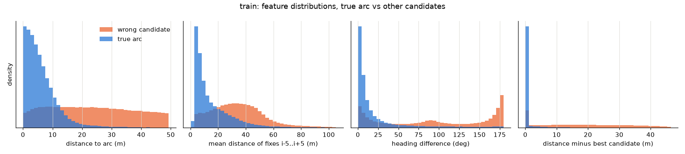

# PathSnap: Labels, Candidates and Features

Auto-generated by `notebooks/03_features.ipynb`.

## Candidate setting (chosen on train only)

```json
{
 "CAND_RADIUS_M": 50.0,
 "MAX_CANDS": 16,
 "rule": "smallest mean candidate set with train miss rate within 0.1 pp of the grid best",
 "train_miss_rate_pct": 0.1111,
 "cands_per_fix": 7.905
}
```

Miss rate (%) by radius (rows) and K (columns), train label-reliable fixes:

|   radius_m |     4 |     6 |     8 |    12 |    16 |    24 |
|-----------:|------:|------:|------:|------:|------:|------:|
|         25 | 3.066 | 1.748 | 1.369 | 1.158 | 1.101 | 1.032 |
|         50 | 2.399 | 0.963 | 0.474 | 0.192 | 0.111 | 0.033 |
|         75 | 2.395 | 0.959 | 0.469 | 0.188 | 0.104 | 0.027 |
|        100 | 2.395 | 0.959 | 0.469 | 0.188 | 0.104 | 0.027 |
|        150 | 2.395 | 0.959 | 0.469 | 0.188 | 0.104 | 0.027 |

Mean candidates per fix:

|   radius_m |    4 |    6 |    8 |    12 |    16 |    24 |
|-----------:|-----:|-----:|-----:|------:|------:|------:|
|         25 | 3.08 | 3.75 | 4.15 |  4.54 |  4.7  |  4.8  |
|         50 | 3.54 | 4.74 | 5.69 |  7.03 |  7.91 |  8.86 |
|         75 | 3.7  | 5.14 | 6.39 |  8.41 |  9.97 | 12.14 |
|        100 | 3.79 | 5.37 | 6.79 |  9.23 | 11.27 | 14.47 |
|        150 | 3.87 | 5.6  | 7.22 | 10.15 | 12.78 | 17.33 |

## Per partition (chosen setting)

|                                |            train |   student_test |
|:-------------------------------|-----------------:|---------------:|
| trips                          |     80           |         10     |
| fixes                          | 208417           |      19160     |
| labelled fixes                 | 188425           |      19157     |
| labelled %                     |     90.41        |         99.98  |
| reliable fixes                 | 180978           |      19133     |
| candidate rows                 |      1.53026e+06 |     169234     |
| cands/fix                      |      7.34        |          8.83  |
| positive rows %                |     12.12        |         11.3   |
| miss rate % (reliable)         |      0.111       |          0.031 |
| miss rate % (labelled)         |      1.578       |          0.157 |
| nearest-arc Top-1 % (reliable) |     55.4         |         51.25  |

## Highest candidate miss rates

| partition   |   trip_id |   n_fixes |   frac_labelled |   frac_reliable |   miss_rate_reliable |   nearest_acc_reliable |
|:------------|----------:|----------:|----------------:|----------------:|---------------------:|-----------------------:|
| train       |  00000072 |       969 |        1        |        1        |           0.0928793  |               0.341589 |
| train       |  00000061 |      1430 |        1        |        0.995105 |           0.0435699  |               0.272663 |
| train       |  00000093 |      1211 |        1        |        0.993394 |           0.0207814  |               0.543641 |
| train       |  00000004 |      1064 |        1        |        1        |           0.0018797  |               0.445489 |
| train       |  00000090 |       536 |        1        |        1        |           0.00186567 |               0.559701 |
| train       |  00000058 |       599 |        1        |        1        |           0.00166945 |               0.572621 |
| train       |  00000081 |      3224 |        0.995968 |        0.968983 |           0.00160051 |               0.731434 |
| train       |  00000069 |      2067 |        1        |        1        |           0.00145138 |               0.474117 |

## Columns

* Keys: `partition, trip_id, fix_idx, segment_id, arc_id`. `trip_id` is the group for GroupKFold.
* Model inputs (`FEATURE_COLS`, 27): `dist_m, dist_rank, dist_minus_min, dist_ratio, n_cands, is_fallback, proj_t, off_end_m, arc_length_m, heading_diff_deg, heading_cos, heading_disp_m, d_prev_m, d_next_m, d_win_mean_m, d_win_max_m, win_mean_rank, win_mean_minus_min, speed_med_mps, dt_prev_s, is_stop, is_fast_step, is_off_network, is_two_way, from_in_deg, to_out_deg, in_largest_scc`.
* Route-based, never inputs (`LABEL_COLS`): `label, true_arc, has_label, label_reliable, exclude_trip, true_in_cands`.
* Training rows: `label_reliable & ~exclude_trip`.




