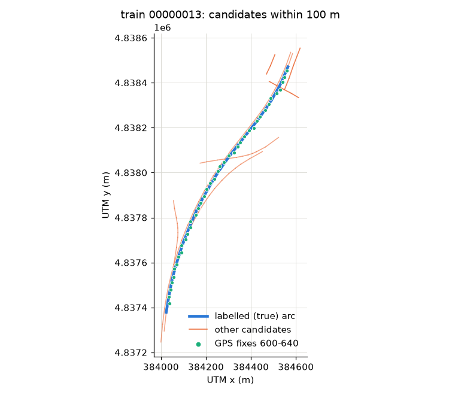
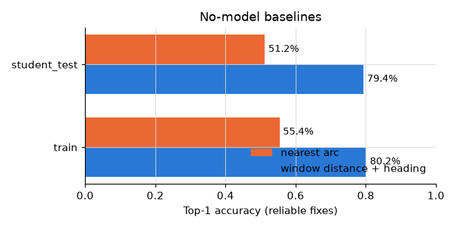

# PathSnap: Candidates, Labels and Features

Auto-generated by `notebooks/03_features.ipynb`.

## Parameters (hand-set)

|                      |   value |
|:---------------------|--------:|
| CAND_RADIUS_M        |     100 |
| MAX_CANDS            |      16 |
| HEADING_HALF_WIN     |       2 |
| CONTEXT_HALF_WIN     |       5 |
| ALIGN_RADIUS_M       |     100 |
| ALIGN_BACK_PENALTY_M |     300 |

## Per partition

| partition    |   trips |   fixes |   candidate rows |   mean cands/fix |   positive rate |   reliable fixes |   miss rate |   nearest-arc Top-1 |
|:-------------|--------:|--------:|-----------------:|-----------------:|----------------:|-----------------:|------------:|--------------------:|
| train        |      80 |  208417 |      2.26183e+06 |             10.9 |          0.0826 |           180978 |      0.001  |              0.554  |
| student_test |      10 |   19160 | 231918           |             12.1 |          0.0826 |            19133 |      0.0003 |              0.5125 |

## No-model baselines (reliable fixes)

| partition    |   nearest-arc Top-1 |   hand rule Top-1 |
|:-------------|--------------------:|------------------:|
| train        |              0.554  |            0.8018 |
| student_test |              0.5125 |            0.7937 |

## Highest candidate miss rates

| partition    |   trip_id |   n_fixes |   frac_reliable |   miss_rate_reliable |   nearest_acc_reliable |
|:-------------|----------:|----------:|----------------:|---------------------:|-----------------------:|
| train        |  00000072 |       969 |        1        |           0.0928793  |               0.341589 |
| train        |  00000061 |      1430 |        0.995105 |           0.0400562  |               0.272663 |
| train        |  00000093 |      1211 |        0.993394 |           0.0207814  |               0.543641 |
| train        |  00000004 |      1064 |        1        |           0.0018797  |               0.445489 |
| train        |  00000090 |       536 |        1        |           0.00186567 |               0.559701 |
| train        |  00000058 |       599 |        1        |           0.00166945 |               0.572621 |
| train        |  00000069 |      2067 |        1        |           0.00145138 |               0.474117 |
| student_test |  00000076 |      1486 |        1        |           0.0013459  |               0.390983 |

## Columns

* Keys: `partition, trip_id, fix_idx, segment_id, arc_id`. `trip_id` is the group for GroupKFold.
* Model inputs (`FEATURE_COLS`, 26): `dist_m, dist_rank, dist_minus_min, dist_ratio, n_cands, is_fallback, proj_t, off_end_m, arc_length_m, heading_diff_deg, heading_cos, heading_disp_m, d_prev_m, d_next_m, d_win_mean_m, d_win_max_m, win_mean_rank, win_mean_minus_min, speed_med_mps, dt_prev_s, is_stop, is_fast_step, is_two_way, from_in_deg, to_out_deg, in_largest_scc`.
* Route-based, never inputs (`LABEL_COLS`): `label, true_arc, has_label, label_reliable, exclude_trip, true_in_cands`.
* Training rows: `label_reliable & ~exclude_trip`.

