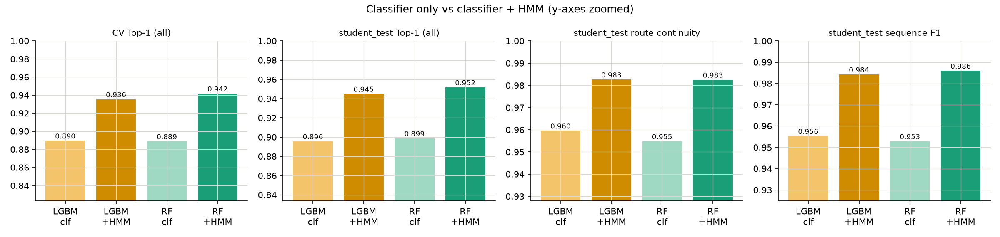
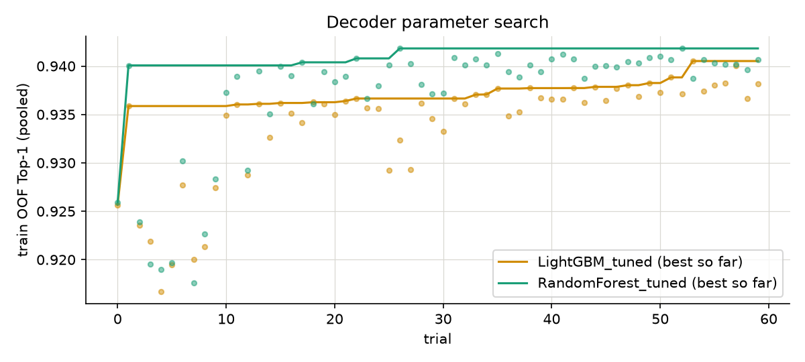
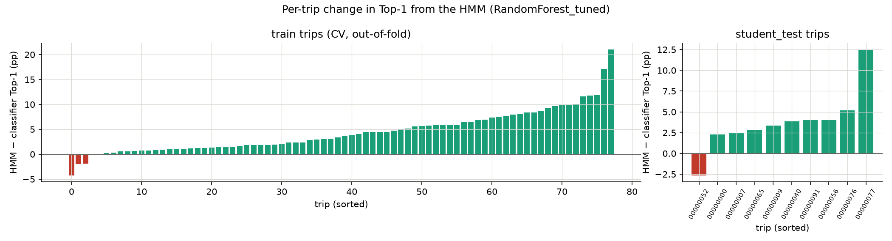

# PathSnap: HMM + Viterbi route reconstruction

Auto-generated by `notebooks/07_hmm_viterbi.ipynb` (seed 42). Every number comes from that run. Code: `src/pathsnap/hmm.py`.

## 1. What are the hidden states?

For every GPS fix, its **candidate arcs**: the directed road arcs within 50 m (at most 16, geometric duplicates merged into one canonical arc), produced by `candidates.py`. The state *is* the canonical arc id that is scored, so the candidate → road-segment correspondence is kept exactly. Mean candidates per fix: 7.3 (train), 8.8 (student_test).

## 2. How are emission probabilities calculated?

log E = log max(p, p_floor), where p is the tuned classifier's probability that this candidate is the true arc. An optional Gaussian distance term −(d/σ)²/2 was part of the search (`use_dist`); the ablation below shows whether it helps. The emission weight is fixed at 1, because only the balance between emission and transition costs changes the Viterbi path, and β already sets it.

## 3. How are transition probabilities calculated?

log A(i→j) = −cost, with cost = min(|route − gps| / β, no_path_pen) + U-turn, stop and speed penalties. *route* is the driving distance along **directed** arcs from the point on arc i to the point on arc j: on the same arc it is the forward distance (backward jitter counts as standing still); to the reverse arc it is a U-turn on the spot (allowed, with `uturn_pen`); otherwise the rest of arc i + the shortest path + the start of arc j. Shortest paths use Dijkstra bounded at gps + max(200 m, gps), one search per source node, cached per trip. *gps* is the straight-line distance between the two fixes. `stop_pen` is added when both fixes are in the same stop and the arc changes; `speed_pen` when route/dt > 50 m/s, except on steps flagged `is_fast_step` (raw GPS speed there is not trustworthy).

**Decoder parameters** were tuned on train out-of-fold probabilities only (Optuna TPE, seed 42, 60 trials for LightGBM_tuned, 60 trials for RandomForest_tuned, objective = pooled OOF Top-1). Final values (search on all 80 train trips):

|                    |   beta_m |   no_path_pen |   uturn_pen |   stop_pen |   speed_pen |     p_floor | use_dist   |   sigma_m |
|:-------------------|---------:|--------------:|------------:|-----------:|------------:|------------:|:-----------|----------:|
| LightGBM_tuned     |  2.58012 |       46.6395 |     19.7021 |    19.1677 |     9.18993 | 0.000768386 | True       |   28.4465 |
| RandomForest_tuned |  3.7408  |       43.4464 |     17.2396 |    11.3217 |     5.72964 | 2.27404e-05 | True       |   32.8413 |

CV numbers below are **nested**: on each fold, the decoder was re-tuned on the other 4 folds (`nested_decoder_params.csv`).

## 4. How are missing candidates or large GPS gaps handled?

* **Gaps > 120 s** (`segment_id` changes): a new Viterbi chain starts, because a shortest path between fixes that far apart is not a safe assumption. Chains: 121 in train, 11 in student_test.
* **No candidate within 50 m:** the fix only has its fallback nearest arc. It is left out of the chain (the chain is carried over it, from the fix before to the fix after), predicted as that nearest arc and flagged `carried_over`. Such fixes: 18230 in train, 0 in student_test.
* **Stops:** while the car is stopped, changing arc costs `stop_pen`, so GPS jitter does not move the match around.

## 5. What happens when consecutive fixes suggest disconnected road segments?

If there is no directed path within the search bound, the transition gets the large but **finite** cost `no_path_pen`. Viterbi never sees −inf, so a chain always continues. Share of candidate pairs with no path: 32.0% (train, mean per trip). For the map, consecutive arcs are joined by the shortest path; where none exists, the drawn route starts a new piece.

## 6. Did HMM decoding improve the route?

Final pipeline: **RandomForest_tuned + HMM** (chosen by mean nested-CV Top-1 with HMM: LightGBM_tuned 0.9359, RandomForest_tuned 0.9423).

|                                       | CV Top-1 (all)   |   CV Top-1 (reliable) |   CV macro F1 (selection) |   CV route continuity |   CV sequence F1 |   CV sequence F1 (filled path) |   ST Top-1 (all) |   ST Top-1 (reliable) |   ST macro F1 (selection) |   ST route continuity | ST sequence P / R / F1   |   ST sequence F1 (filled path) |
|:--------------------------------------|:-----------------|----------------------:|--------------------------:|----------------------:|-----------------:|-------------------------------:|-----------------:|----------------------:|--------------------------:|----------------------:|:-------------------------|-------------------------------:|
| LightGBM_tuned · classifier only      | 0.8900 ± 0.0384  |                0.8942 |                    0.9388 |                0.9575 |           0.9363 |                         0.9348 |           0.8961 |                0.8972 |                    0.9418 |                0.9597 | 0.929 / 0.983 / 0.956    |                         0.9475 |
| LightGBM_tuned · classifier + HMM     | 0.9359 ± 0.0321  |                0.9404 |                    0.9651 |                0.9783 |           0.9771 |                         0.9864 |           0.9454 |                0.9466 |                    0.9696 |                0.9828 | 0.985 / 0.984 / 0.984    |                         0.9896 |
| RandomForest_tuned · classifier only  | 0.8894 ± 0.0365  |                0.8935 |                    0.9384 |                0.9548 |           0.9323 |                         0.9292 |           0.8992 |                0.9003 |                    0.9436 |                0.955  | 0.924 / 0.984 / 0.953    |                         0.9429 |
| RandomForest_tuned · classifier + HMM | 0.9423 ± 0.0252  |                0.9468 |                    0.9687 |                0.9782 |           0.9779 |                         0.9874 |           0.9523 |                0.9535 |                    0.9735 |                0.9827 | 0.987 / 0.985 / 0.986    |                         0.9915 |

Ablation (train OOF, pooled Top-1, one part switched off at a time):

|                                                          |   train OOF Top-1 |   vs best (pp) |
|:---------------------------------------------------------|------------------:|---------------:|
| ('LightGBM_tuned', 'best decoder')                       |            0.9405 |         0      |
| ('LightGBM_tuned', 'no U-turn penalty')                  |            0.9008 |        -3.9714 |
| ('LightGBM_tuned', 'no stop handling')                   |            0.9334 |        -0.7072 |
| ('LightGBM_tuned', 'no speed penalty')                   |            0.9402 |        -0.0269 |
| ('LightGBM_tuned', 'Gaussian distance term removed')     |            0.9405 |        -0.0049 |
| ('LightGBM_tuned', 'classifier only (no HMM)')           |            0.8916 |        -4.8892 |
| ('RandomForest_tuned', 'best decoder')                   |            0.9418 |         0      |
| ('RandomForest_tuned', 'no U-turn penalty')              |            0.9021 |        -3.9736 |
| ('RandomForest_tuned', 'no stop handling')               |            0.9348 |        -0.7039 |
| ('RandomForest_tuned', 'no speed penalty')               |            0.9406 |        -0.1201 |
| ('RandomForest_tuned', 'Gaussian distance term removed') |            0.9416 |        -0.0258 |
| ('RandomForest_tuned', 'classifier only (no HMM)')       |            0.8908 |        -5.1068 |

Fixes that changed (RandomForest_tuned), by outcome and by how the wrong arc relates to the reference arc:

|                                                           |   CV (train OOF) |   student_test |
|:----------------------------------------------------------|-----------------:|---------------:|
| ('broken by HMM', 'other road (parallel / nearby)')       |              221 |             34 |
| ('broken by HMM', 'reverse direction (two-way street)')   |              984 |            107 |
| ('broken by HMM', 'touching arc (shares a node)')         |              916 |            103 |
| ('fixed by HMM', 'other road (parallel / nearby)')        |             1855 |            245 |
| ('fixed by HMM', 'reverse direction (two-way street)')    |             6846 |            661 |
| ('fixed by HMM', 'touching arc (shares a node)')          |             2704 |            355 |
| ('wrong both ways', 'other road (parallel / nearby)')     |              637 |             21 |
| ('wrong both ways', 'reverse direction (two-way street)') |              111 |             19 |
| ('wrong both ways', 'touching arc (shares a node)')       |              987 |            126 |

Stopped vs moving fixes (CV):

| is_stop   |   fixes |   classifier Top-1 |   HMM Top-1 |
|:----------|--------:|-------------------:|------------:|
| False     |  162616 |             0.9293 |      0.9687 |
| True      |   19787 |             0.5738 |      0.7191 |

Per student_test trip:

|   trip_id |   fixes |   classifier |    HMM |   gain_pp |
|----------:|--------:|-------------:|-------:|----------:|
|  00000052 |     262 |       0.9771 | 0.9504 |   -2.6718 |
|  00000000 |    2503 |       0.9549 | 0.9776 |    2.2773 |
|  00000007 |    1354 |       0.9705 | 0.9956 |    2.5111 |
|  00000065 |     768 |       0.8672 | 0.8958 |    2.8646 |
|  00000009 |    1049 |       0.8827 | 0.9161 |    3.3365 |
|  00000040 |    2995 |       0.9469 | 0.9853 |    3.8397 |
|  00000091 |     874 |       0.9027 | 0.9428 |    4.0046 |
|  00000056 |    3955 |       0.912  | 0.9522 |    4.0202 |
|  00000076 |    1486 |       0.9253 | 0.9771 |    5.1817 |
|  00000077 |    3911 |       0.7842 | 0.9095 |   12.5288 |

Decode time per student_test trip (state-space build incl. Dijkstra + Viterbi):

|   trip_id |   fixes |   build_s |   viterbi_s |   ms_per_1k_fixes |
|----------:|--------:|----------:|------------:|------------------:|
|  00000000 |    2503 |     0.168 |       0.022 |            75.761 |
|  00000007 |    1354 |     0.082 |       0.012 |            69.594 |
|  00000009 |    1049 |     0.147 |       0.017 |           156.257 |
|  00000040 |    2995 |     0.163 |       0.029 |            64.293 |
|  00000052 |     262 |     0.022 |       0.002 |            95.099 |
|  00000056 |    3958 |     0.342 |       0.084 |           107.656 |
|  00000065 |     768 |     0.087 |       0.011 |           127.291 |
|  00000076 |    1486 |     0.216 |       0.036 |           169.673 |
|  00000077 |    3911 |     0.367 |       0.079 |           114.064 |
|  00000091 |     874 |     0.135 |       0.012 |           168.216 |

`predict_trip` (raw files → route) check against the notebook:

|   trip_id |   fixes |   same_as_notebook |   path_pieces |   clean_features_s |   classifier_s |   hmm_build_s |   viterbi_s |   total_s |
|----------:|--------:|-------------------:|--------------:|-------------------:|---------------:|--------------:|------------:|----------:|
|  00000077 |    3911 |                  1 |             1 |               0.59 |           0.13 |          0.29 |        0.05 |      1.07 |
|  00000052 |     262 |                  1 |             1 |               0.18 |           0.09 |          0.03 |        0    |      0.3  |

## Reading the results (written after this run)

* **The HMM is the biggest single improvement in the project.** With the final pipeline (tuned Random Forest + HMM),
  nested-CV Top-1 rises from 0.8894 to 0.9423 (+5.3 pp) and student_test Top-1 from 0.8992 to 0.9523 (+5.3 pp).
  The HMM is better than the classifier alone in all 5 folds, for both classifiers. Route continuity goes from 0.955
  to 0.983 on student_test. Sequence F1 goes from 0.953 to 0.986, mostly through precision (0.924 to 0.987): the
  classifier alone scatters fixes onto arcs that are not on the route, and the HMM removes most of them.
* **Why Random Forest + HMM was chosen:** it has the higher mean nested-CV Top-1 with the HMM (0.9423 vs 0.9359 for
  LightGBM), is ahead in 4 of 5 folds, and also has a lower fold-to-fold spread (± 0.025 vs ± 0.032). It is ahead on
  student_test too (0.9523 vs 0.9454), but the choice was made from CV only. Without the HMM the two classifiers were
  tied. With it they separate, so the decoder changes which classifier is better. LightGBM has the better log loss, so
  this shows that log loss alone did not predict which model works best inside the HMM.
* **What does the work:** the ablation (train out-of-fold) shows that the **U-turn penalty** matters most. Without it,
  Top-1 drops by about 4 pp, because the HMM then switches freely to the reverse arc of a two-way street. **Stop
  handling** is next (about 0.7 pp). The speed penalty (0.03–0.12 pp) and the Gaussian distance term (≤ 0.03 pp) add
  almost nothing, because the classifier already uses distance and the speed check rarely fires at 1 Hz.
* **Where the HMM helps:** most fixes it corrects were on the **reverse direction of a two-way street**: 6,846 in CV
  and 661 on student_test. The classifier cannot tell the two directions apart from one noisy fix, but the sequence
  can. Next come arcs that touch the true arc (2,704 / 355) and parallel or nearby roads (1,855 / 245). On stopped
  fixes, classifier Top-1 is only 0.574 and the HMM lifts it to 0.719. The parked jitter leaves the heading
  meaningless, so the sequence is the only signal.
* **Where it does not help:** for every 5 fixes the HMM corrects, it breaks about 1 (2,121 broken vs 11,405 fixed in
  CV; 244 vs 1,261 on student_test). These are mostly the same two cases: reverse direction (984) and touching arcs
  (916). 5 of 78 train trips and 1 of 10 student_test trips got worse. Another 1,735 CV fixes changed from one wrong arc
  to another wrong arc.
* **Example where it helps (student_test trip 77):** Top-1 goes from 0.784 to 0.910 (+12.5 pp), the largest gain. The
  car is stopped for 40 % of the trip. The classifier flips between the two directions of the street while it is
  parked, and the HMM keeps one consistent arc. Of the 610 fixes it corrects, 487 were on the reverse direction and
  443 were during stops. It also breaks 120 fixes (100 reverse direction, 102 during stops), so stops are where it
  both helps and hurts the most.
* **Example where it does not help (student_test trip 52):** a short trip (262 fixes) where Top-1 goes from 0.977 to
  0.950 (−2.7 pp). All 9 broken fixes are between fix 22 and fix 50, during a stop near a junction. The stop penalty
  keeps the car on one arc, but the reference labels move to the next (touching) arc during that stop. The stop
  detector (less than 30 m of movement over 60 fixes) may also catch slow driving through a junction, and then a strong
  stop penalty is wrong. On such a short trip, 9 fixes is already 2.7 pp.
* **Boundary values:** in all 12 decoder searches (final and nested, both classifiers), `uturn_pen` ended at 17–20,
  near the top of its 0–20 range. `stop_pen` (10–20) is also high. A wider range might gain a little more, but the
  ablation suggests most of the effect is already captured. `use_dist` was always chosen as True, but its effect is
  negligible.
* **Honesty notes:** the CV numbers are nested (the decoder was re-tuned without the scored fold). The ablation and the
  "where it helps" counts use the decoder tuned on all train trips, so they describe the decoder rather than test it.
  On average 32 % of candidate pairs have no path within the search bound, mostly pairs whose arcs point in opposite
  directions. They get the finite `no_path_pen`, so no chain ever breaks.
* **Speed:** the HMM stage (state space with Dijkstra + Viterbi) takes 64–170 ms per 1,000 fixes on student_test, at
  most 0.45 s for a trip. The whole `predict_trip` from raw files takes 1.1 s for the 3,911-fix trip 77. It gives
  exactly the same arcs as the notebook (`same_as_notebook` = 1.0).

## Figures and maps

* [trip_00000040_median_gain](maps/trip_00000040_median_gain.html)
* [trip_00000052_smallest_gain](maps/trip_00000052_smallest_gain.html)
* [trip_00000077_largest_gain](maps/trip_00000077_largest_gain.html)
