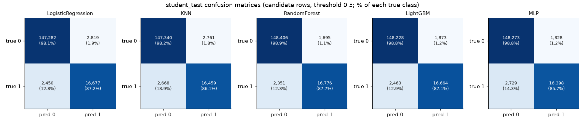
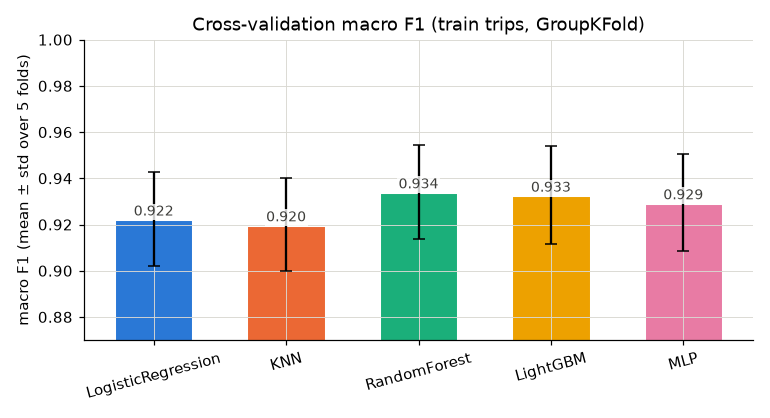
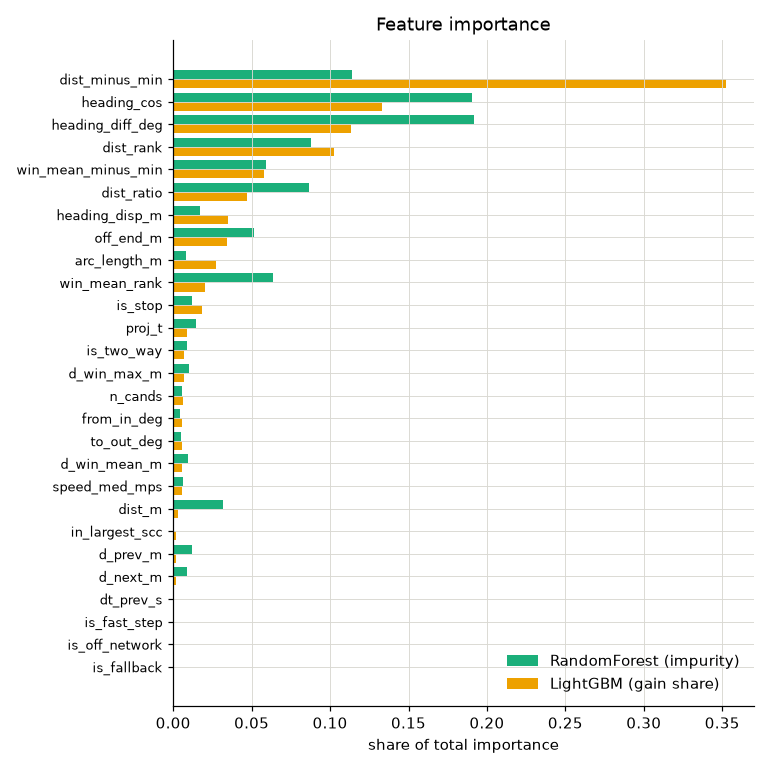
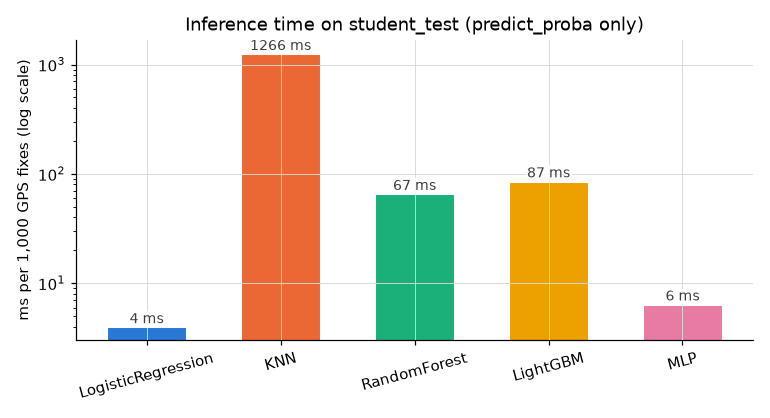
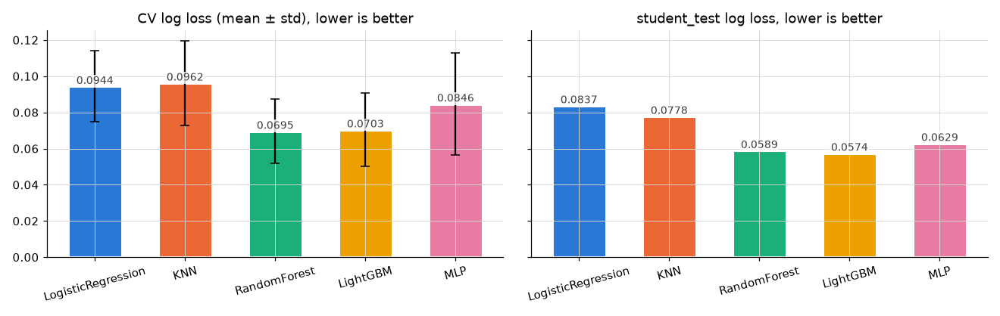
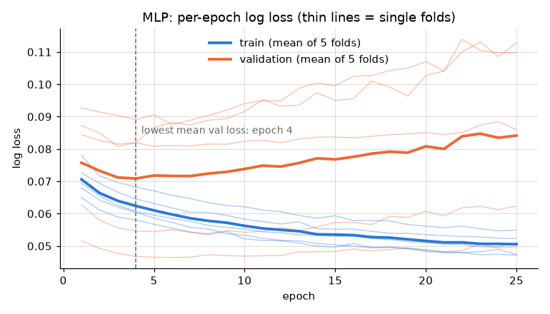
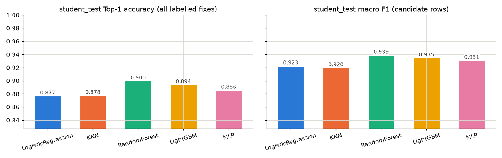

# PathSnap: Model Comparison (step 4)

Auto-generated by `notebooks/04_model_training.ipynb`. Every number comes from that run (seed 42).

* CV = 5-fold GroupKFold on trip_id over the 80 train trips (mean ± std over folds).
* ST = student_test (10 trips), scored once after refitting on all usable train trips.
* Top-1 = share of GPS fixes whose highest-probability candidate is the true arc (a fix whose true arc is not a candidate counts as wrong). Macro F1 / precision / recall / log loss are on candidate rows at threshold 0.5.
* all = labelled fixes of non-excluded trips; reliable = label_reliable fixes only.
* Route continuity = share of consecutive fix pairs whose predicted arcs are the same or connected (reference labels: 0.9849).

## Main table

| model              | family             | CV macro F1     | CV Top-1 (all)   |   ST Top-1 (all) |   ST Top-1 (reliable) |   ST macro F1 (all) |   ST log loss (all) |   ST route continuity |   inference ms / 1k fixes |
|:-------------------|:-------------------|:----------------|:-----------------|-----------------:|----------------------:|--------------------:|--------------------:|----------------------:|--------------------------:|
| LogisticRegression | Linear             | 0.9225 ± 0.0203 | 0.8778 ± 0.0369  |           0.8772 |                0.8783 |              0.923  |              0.0837 |                0.9469 |                       4   |
| KNN                | Instance-based     | 0.9200 ± 0.0201 | 0.8733 ± 0.0374  |           0.8779 |                0.879  |              0.9202 |              0.0778 |                0.9488 |                    1265.7 |
| RandomForest       | Ensemble (bagging) | 0.9342 ± 0.0203 | 0.8871 ± 0.0372  |           0.9001 |                0.9012 |              0.9395 |              0.0589 |                0.9556 |                      66.6 |
| LightGBM           | Boosting           | 0.9328 ± 0.0212 | 0.8851 ± 0.0379  |           0.8943 |                0.8955 |              0.9352 |              0.0574 |                0.9595 |                      86.7 |
| MLP                | Neural network     | 0.9295 ± 0.0209 | 0.8793 ± 0.0390  |           0.886  |                0.8871 |              0.9314 |              0.0629 |                0.9586 |                       6.5 |

## More student_test detail

| model              |   ST precision |   ST recall |   ST macro F1 (reliable) |   ST log loss (reliable) |   ST miss rate (all) |   train time (s) |   model file (MB) |
|:-------------------|---------------:|------------:|-------------------------:|-------------------------:|---------------------:|-----------------:|------------------:|
| LogisticRegression |         0.8554 |      0.8719 |                   0.9233 |                   0.0834 |              0.00157 |              4.6 |               0   |
| KNN                |         0.8563 |      0.8605 |                   0.9206 |                   0.0776 |              0.00157 |              0.1 |              17.5 |
| RandomForest       |         0.9082 |      0.8771 |                   0.9398 |                   0.0586 |              0.00157 |             93.1 |              17.8 |
| LightGBM           |         0.899  |      0.8712 |                   0.9355 |                   0.0571 |              0.00157 |             29   |               1.3 |
| MLP                |         0.8997 |      0.8573 |                   0.9317 |                   0.0626 |              0.00157 |             20.7 |               0.1 |

## Cross-validation (mean ± std over 5 folds)

|                    | all_macro_f1    | all_top1        | reliable_top1   | reliable_macro_f1   | all_logloss     | route_continuity   | fit_s              |
|:-------------------|:----------------|:----------------|:----------------|:--------------------|:----------------|:-------------------|:-------------------|
| LogisticRegression | 0.9225 ± 0.0203 | 0.8778 ± 0.0369 | 0.8819 ± 0.0337 | 0.9232 ± 0.0197     | 0.0944 ± 0.0196 | 0.9426 ± 0.0209    | 4.5328 ± 1.3069    |
| KNN                | 0.9200 ± 0.0201 | 0.8733 ± 0.0374 | 0.8773 ± 0.0338 | 0.9203 ± 0.0199     | 0.0962 ± 0.0233 | 0.9492 ± 0.0182    | 0.1453 ± 0.0628    |
| RandomForest       | 0.9342 ± 0.0203 | 0.8871 ± 0.0372 | 0.8912 ± 0.0334 | 0.9347 ± 0.0199     | 0.0695 ± 0.0178 | 0.9557 ± 0.0147    | 60.7194 ± 27.8430  |
| LightGBM           | 0.9328 ± 0.0212 | 0.8851 ± 0.0379 | 0.8892 ± 0.0342 | 0.9332 ± 0.0210     | 0.0703 ± 0.0202 | 0.9581 ± 0.0148    | 12.3432 ± 1.7803   |
| MLP                | 0.9295 ± 0.0209 | 0.8793 ± 0.0390 | 0.8833 ± 0.0364 | 0.9298 ± 0.0209     | 0.0846 ± 0.0282 | 0.9542 ± 0.0190    | 139.2616 ± 53.4609 |

## Configurations

| model              | family             | key config                                                                                                                                                                                          |
|:-------------------|:-------------------|:----------------------------------------------------------------------------------------------------------------------------------------------------------------------------------------------------|
| LogisticRegression | Linear             | log1p + StandardScaler; C=1.0, solver=lbfgs, max_iter=1000                                                                                                                                          |
| KNN                | Instance-based     | log1p + StandardScaler; trained on a random 150,000-row sample; n_neighbors=50, weights=uniform, algorithm=auto                                                                                     |
| RandomForest       | Ensemble (bagging) | raw features (trees do not need scaling); n_estimators=150, max_features=sqrt, min_samples_leaf=20, max_samples=0.3, bootstrap=True                                                                 |
| LightGBM           | Boosting           | raw features; n_estimators=400, learning_rate=0.05, num_leaves=63, min_child_samples=50, subsample=0.8, subsample_freq=1, colsample_bytree=0.8, reg_lambda=1.0                                      |
| MLP                | Neural network     | log1p + StandardScaler; trained with partial_fit one epoch at a time; hidden_layer_sizes=(64, 32), activation=relu, solver=adam, alpha=0.0001, batch_size=1024, learning_rate_init=0.001, epochs=25 |

MLP final epochs = 4 (lowest mean CV validation loss). Full configs: `configs.json`; per-fold results: `per_fold.csv`; log: `experiment_log.jsonl`.

## Figures

## Discussion (written after reading this run's results)

* **All five models clearly beat the no-model baseline.** Picking the nearest arc gets 51–55 % Top-1; every model gets
  0.87–0.90 on student_test. Most of the gain comes from the heading and window-consistency features, which separate
  the two directions of a two-way street (see `feature_importance.png`).
* **Random Forest has the best accuracy, but only just.** CV Top-1 is 0.8871 vs 0.8851 for LightGBM, and RF is ahead
  in all 5 folds by 0.02–0.50 percentage points. On student_test it is 0.9001 vs 0.8943. The ± 0.037 fold spread is
  mostly differences in difficulty between trips: every model rises and falls together across folds (`per_fold.csv`).
* **Probability quality is a tie between RF and LightGBM.** CV log loss is 0.0695 (RF) vs 0.0703 (LightGBM); student_test
  log loss is 0.0589 vs 0.0574. Both are well ahead of LR, KNN and the MLP. This matters because the HMM will use these
  probabilities as emission scores.
* **Cost:** LightGBM trains about 3× faster than RF (29 s vs 93 s for the final fit) and its file is about 14× smaller
  (1.3 MB vs 17.8 MB). Inference is similar (67–87 ms per 1,000 fixes). KNN is by far the slowest at prediction
  (about 1.3 s per 1,000 fixes), even though it was trained on only a 150k-row sample.
* **Over/underfitting:** the MLP's validation loss is lowest at epoch 4 and then rises while its training loss keeps
  falling (`mlp_loss_curves.png`), which is clear overfitting. The final MLP therefore uses 4 epochs. Logistic
  Regression underfits a little: it is the weakest on log loss, because a linear boundary cannot fully use the
  interactions (for example, heading only matters when the car is moving).
* **Route continuity:** classifier-only predictions give connected consecutive arcs 94–96 % of the time, against
  98.5 % for the reference labels. The remaining jumps between unconnected arcs are what the HMM/Viterbi step should
  remove.
* **Candidate generation is not the bottleneck:** the student_test miss rate is 0.16 % (all labelled fixes), so almost all
  of the ~10 % Top-1 error comes from choosing the wrong candidate, not from a missing one.
