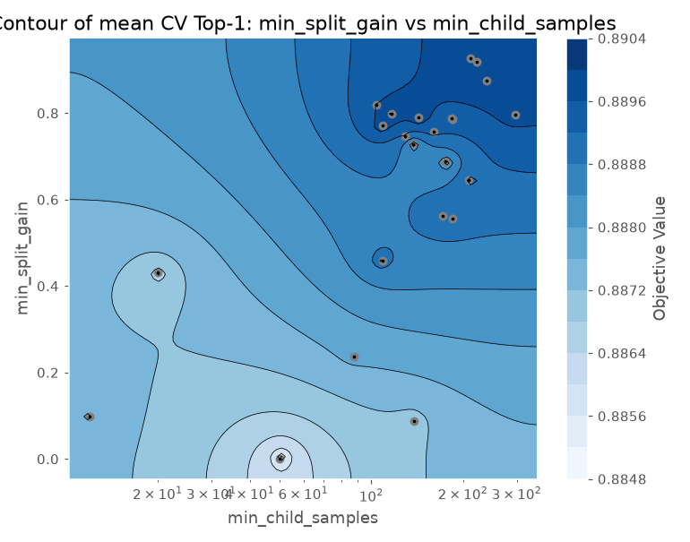
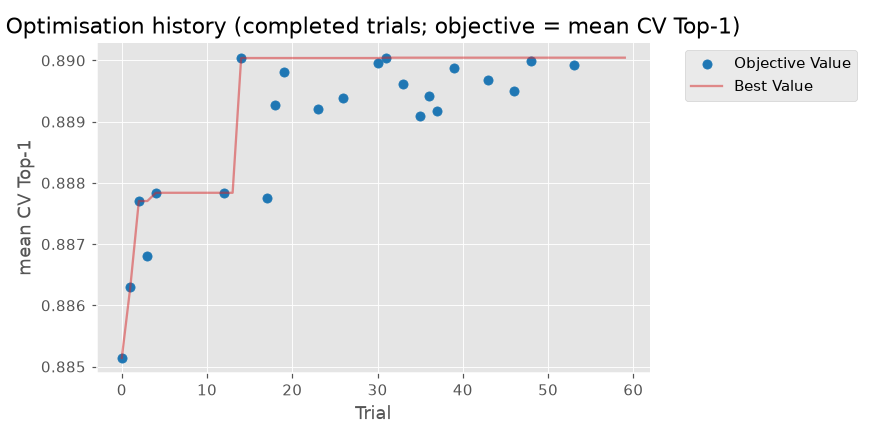
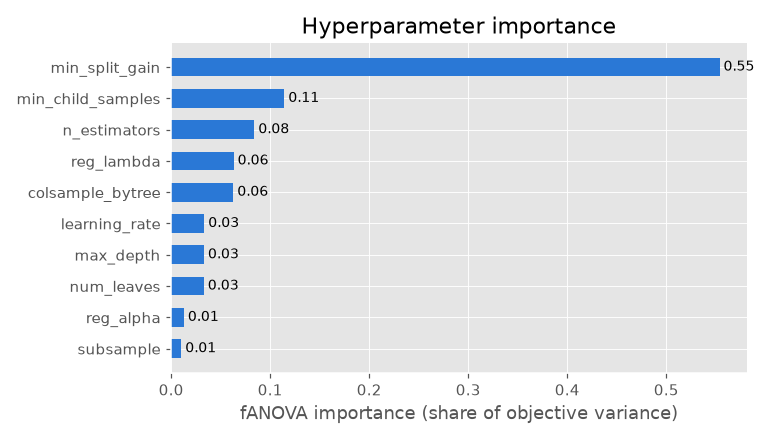
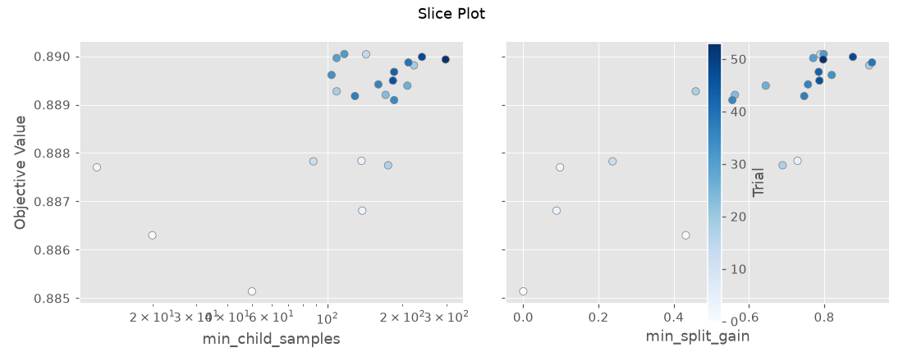
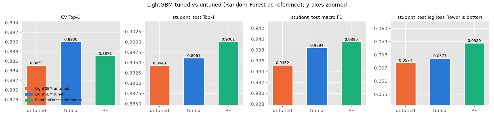

# PathSnap: Bayesian Hyperparameter Optimisation of LightGBM

Auto-generated by `notebooks/05_bayesian_tuning.ipynb` (seed 42). Every number comes from that run.

## 1. Which hyperparameters were searched?

learning_rate, n_estimators, num_leaves, max_depth, min_child_samples, subsample (with subsample_freq=1), colsample_bytree, reg_alpha, reg_lambda, min_split_gain.

## 2. What ranges / distributions?

|                   | type        |     low |   high | log   |   step | choices                            |
|:------------------|:------------|--------:|-------:|:------|-------:|:-----------------------------------|
| learning_rate     | float       |   0.01  |    0.2 | True  |        |                                    |
| n_estimators      | int         | 100     | 1500   |       |     50 |                                    |
| num_leaves        | int         |  15     |  255   | True  |        |                                    |
| max_depth         | categorical |         |        |       |        | [-1, 4, 5, 6, 7, 8, 9, 10, 11, 12] |
| min_child_samples | int         |  10     |  300   | True  |        |                                    |
| subsample         | float       |   0.5   |    1   |       |        |                                    |
| colsample_bytree  | float       |   0.4   |    1   |       |        |                                    |
| reg_alpha         | float       |   1e-08 |   10   | True  |        |                                    |
| reg_lambda        | float       |   1e-08 |   10   | True  |        |                                    |
| min_split_gain    | float       |   0     |    1   |       |        |                                    |

## 3. What objective was optimised?

Maximise the **mean CV observation-level Top-1 accuracy** (all labelled fixes of non-excluded trips) over the same 5 GroupKFold folds (by trip, seed 42) as notebook 04. Top-1 is the real task: for each GPS fix, pick the right road. Macro F1 and log loss score single candidate rows at a 0.5 threshold, which the pipeline never uses, so they were logged for every trial but not optimised. Sampler: TPE (seed 42). Pruner: MedianPruner (from the first fold, after 5 finished trials). student_test was not used during the search.

## 4. How many trials?

60 trials in 41.9 min: 23 completed, 37 pruned, 0 failed (limit: 60 trials or 75 min). Trial 0 was the untuned configuration.

## 5. Best hyperparameters

Best trial: #31, mean CV Top-1 = 0.8900.

|                   |   best value |   untuned value |
|:------------------|-------------:|----------------:|
| learning_rate     |    0.0393366 |           0.05  |
| n_estimators      |  600         |         400     |
| num_leaves        |   23         |          63     |
| max_depth         |   12         |          -1     |
| min_child_samples |  117         |          50     |
| subsample         |    0.517878  |           0.8   |
| colsample_bytree  |    0.409403  |           0.8   |
| reg_alpha         |    0.0123224 |           1e-08 |
| reg_lambda        |    0.0529555 |           1     |
| min_split_gain    |    0.798387  |           0     |

## 6. Did the tuned model beat the untuned one?

CV Top-1 changed by +0.49 percentage points (higher in 5 of 5 folds); student_test Top-1 changed by +0.18 pp. Full comparison (untuned LightGBM and Random Forest from notebook 04):

|                          |   CV macro F1 |   CV macro F1 std |   CV Top-1 |   CV Top-1 std |   CV log loss |   ST Top-1 |   ST Top-1 (reliable) |   ST macro F1 |   ST log loss |   ST route continuity |   train time (s) |   inference ms / 1k fixes |   model file (MB) |
|:-------------------------|--------------:|------------------:|-----------:|---------------:|--------------:|-----------:|----------------------:|--------------:|--------------:|----------------------:|-----------------:|--------------------------:|------------------:|
| LightGBM untuned         |        0.9328 |            0.0212 |     0.8851 |         0.0379 |        0.0703 |     0.8943 |                0.8955 |        0.9352 |        0.0574 |                0.9595 |          29      |                   86.7    |            1.3    |
| LightGBM tuned           |        0.9362 |            0.0207 |     0.89   |         0.0384 |        0.0681 |     0.8961 |                0.8972 |        0.9384 |        0.0577 |                0.9597 |          15.8134 |                   49.6453 |            0.7036 |
| RandomForest (reference) |        0.9342 |            0.0203 |     0.8871 |         0.0372 |        0.0695 |     0.9001 |                0.9012 |        0.9395 |        0.0589 |                0.9556 |          93.1    |                   66.6    |           17.8    |

Per fold, CV Top-1:

|        |   untuned |   tuned |   RandomForest |   tuned - untuned (pp) |   tuned - RF (pp) |
|:-------|----------:|--------:|---------------:|-----------------------:|------------------:|
| fold 0 |    0.8474 |  0.8515 |         0.8486 |                 0.4139 |            0.292  |
| fold 1 |    0.9178 |  0.9274 |         0.919  |                 0.9603 |            0.8443 |
| fold 2 |    0.8782 |  0.8846 |         0.8832 |                 0.6357 |            0.1369 |
| fold 3 |    0.9307 |  0.9319 |         0.9309 |                 0.1167 |            0.0979 |
| fold 4 |    0.8515 |  0.8548 |         0.8537 |                 0.3258 |            0.1129 |

## Figures

## Reading the results (written after this run)

* **Tuning helped, but only a little.** CV Top-1 went from 0.8851 to 0.8900 (+0.49 pp), higher in all 5 folds
  (+0.12 to +0.96 pp). That is consistent, so it is not one lucky fold. On student_test, Top-1 went from 0.8943 to 0.8961
  (+0.18 pp) and macro F1 from 0.9352 to 0.9384. Student_test log loss stayed about the same (0.0574 → 0.0577).
* **Random Forest:** tuned LightGBM now beats it in cross-validation (0.8900 vs 0.8871, ahead in all 5 folds), but RF
  is still higher on student_test Top-1 (0.9001 vs 0.8961). These 10 trips are only one sample, and the gaps are a few
  tenths of a percentage point.
* **What the search learned:** the best region is a *simpler, more regularised* model than the untuned one. It has fewer
  leaves (17–34 instead of 63), large `min_child_samples` (100–300), a high `min_split_gain` (~0.6–0.9), and strong row
  and column subsampling. fANOVA attributes 55 % of the score variance to `min_split_gain`. The untuned model was
  slightly overfitting the training trips.
* **Plateau:** the 10 best completed trials are within 0.0005 CV Top-1 of each other, so the exact best values are not
  important. Trial 31 is reported because it is the first one that reached that level.
* **Boundary values:** every top trial picked `max_depth = 12`, but with only ~23 leaves a depth of 12 never limits
  the tree, so this is effectively "no depth limit". The best `min_split_gain` (0.80) is near the top of its 0–1
  range. A wider range might give a little more, but the plateau suggests the gain would be small.
* **Pruning:** 37 of 60 trials were stopped early (33 of them after one fold), so the search took 42 min instead of
  hours. Pruned trials do not have a comparable score: `trials.csv` keeps their running mean separately and leaves
  `value` empty.
* **Training and inference cost:** the tuned model trains in 16 s (untuned 29 s in notebook 04) and its file is 0.7 MB
  (vs 1.3 MB). The inference figure of 86.7 ms / 1k fixes for the untuned model comes from notebook 04 under a different
  machine load. Re-timed in the same session, untuned took **40 ms** and tuned **50 ms** per 1,000 fixes. The tuned
  model has more trees (600 vs 400), so it is slightly *slower* at prediction, though still fast.
* **Sanity check:** trial 0 (the untuned configuration, re-run inside the search) reproduced notebook 04's per-fold Top-1
  exactly, so the folds, rows and metrics are identical between the two notebooks.
