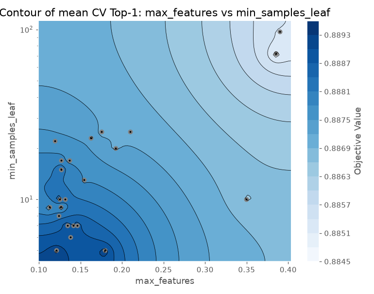
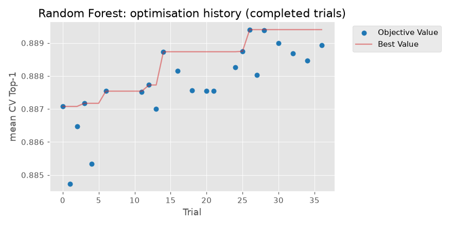
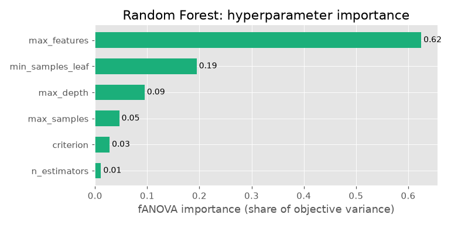
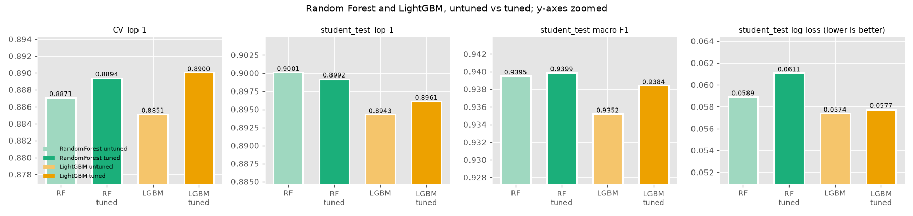
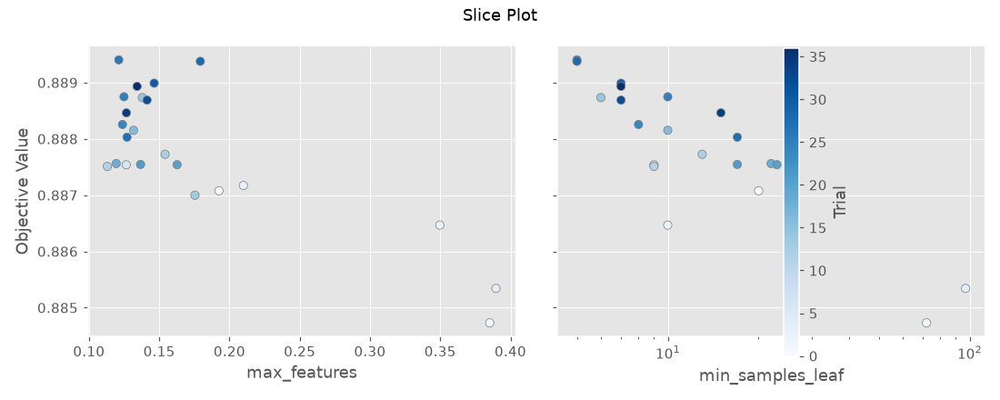

# PathSnap: Bayesian Hyperparameter Optimisation of Random Forest

Auto-generated by `notebooks/06_bayesian_tuning_rf.ipynb` (seed 42). Every number comes from that run, except the untuned rows (notebook 04) and the tuned LightGBM row (notebook 05), which are read from their saved outputs.

## 1. Which hyperparameters were searched?

n_estimators, max_features, min_samples_leaf, max_samples, max_depth, criterion (bootstrap=True).

## 2. What ranges / distributions?

|                  | type        |   low |   high |   step |   log | choices                |
|:-----------------|:------------|------:|-------:|-------:|------:|:-----------------------|
| n_estimators     | int         |  50   | 250    |     25 |   nan | nan                    |
| max_features     | float       |   0.1 |   0.4  |    nan |   nan | nan                    |
| min_samples_leaf | int         |   5   | 200    |    nan |  True | nan                    |
| max_samples      | float       |   0.1 |   0.35 |    nan |   nan | nan                    |
| max_depth        | categorical | nan   | nan    |    nan |   nan | [None, 10, 15, 20, 30] |
| criterion        | categorical | nan   | nan    |    nan |   nan | ['gini', 'entropy']    |

max_features and max_samples were capped (0.4 / 0.35) to fit the ~75 min time budget: one fold at 250 trees / 0.5 / 0.4 took about 4 min in a timing test.

## 3. What objective was optimised?

Maximise the **mean CV observation-level Top-1 accuracy** (all labelled fixes of non-excluded trips) over the same 5 GroupKFold folds (by trip, seed 42) as notebooks 04 and 05, the same objective as for LightGBM. Sampler: TPE (seed 42). Pruner: MedianPruner (from the first fold, after 5 finished trials). student_test was not used during the search.

## 4. How many trials?

37 trials in 76.4 min: 23 completed, 14 pruned, 0 failed (limit: 40 trials or 75 min). Trial 0 was the untuned configuration.

## 5. Best hyperparameters

Best trial: #26, mean CV Top-1 = 0.8894.

|                  | best value          | untuned value   |
|:-----------------|:--------------------|:----------------|
| n_estimators     | 175                 | 150             |
| max_features     | 0.1211970669619417  | 0.1925          |
| min_samples_leaf | 5                   | 20              |
| max_samples      | 0.34387510983753256 | 0.3             |
| max_depth        | 15                  | nan             |
| criterion        | entropy             | gini            |

## 6. Did the tuned model beat the untuned one?

CV Top-1 changed by +0.23 percentage points (higher in 4 of 5 folds); student_test Top-1 changed by -0.09 pp. Comparison with LightGBM (inference times re-measured in this session for all four models):

|                      |   CV macro F1 |   CV Top-1 |   CV Top-1 std |   CV log loss |   ST Top-1 |   ST Top-1 (reliable) |   ST macro F1 |   ST log loss |   ST route continuity |   train time (s) |   model file (MB) |   inference ms / 1k fixes (this session) |
|:---------------------|--------------:|-----------:|---------------:|--------------:|-----------:|----------------------:|--------------:|--------------:|----------------------:|-----------------:|------------------:|-----------------------------------------:|
| RandomForest untuned |        0.9342 |     0.8871 |         0.0372 |        0.0695 |     0.9001 |                0.9012 |        0.9395 |        0.0589 |                0.9556 |          93.1    |           17.8    |                                  16.2458 |
| RandomForest tuned   |        0.9356 |     0.8894 |         0.0365 |        0.0714 |     0.8992 |                0.9003 |        0.9399 |        0.0611 |                0.955  |          43.4189 |           22.7946 |                                  17.764  |
| LightGBM untuned     |        0.9328 |     0.8851 |         0.0379 |        0.0703 |     0.8943 |                0.8955 |        0.9352 |        0.0574 |                0.9595 |          29      |            1.3    |                                  39.1094 |
| LightGBM tuned       |        0.9362 |     0.89   |         0.0384 |        0.0681 |     0.8961 |                0.8972 |        0.9384 |        0.0577 |                0.9597 |          15.8134 |            0.7036 |                                  49.9534 |

Per fold, CV Top-1:

|        |   RF untuned |   RF tuned |   LightGBM untuned |   LightGBM tuned |   RF tuned - RF untuned (pp) |   RF tuned - LGBM tuned (pp) |
|:-------|-------------:|-----------:|-------------------:|-----------------:|-----------------------------:|-----------------------------:|
| fold 0 |       0.8486 |     0.8544 |             0.8474 |           0.8515 |                       0.5738 |                       0.2818 |
| fold 1 |       0.919  |     0.9232 |             0.9178 |           0.9274 |                       0.426  |                      -0.4184 |
| fold 2 |       0.8832 |     0.8849 |             0.8782 |           0.8846 |                       0.1703 |                       0.0335 |
| fold 3 |       0.9309 |     0.9304 |             0.9307 |           0.9319 |                      -0.049  |                      -0.1469 |
| fold 4 |       0.8537 |     0.8541 |             0.8515 |           0.8548 |                       0.0419 |                      -0.071  |

## Figures

## Reading the results (written after this run)

* **Tuning barely helped Random Forest.** CV Top-1 went from 0.8871 to 0.8894 (+0.23 pp), higher in 4 of 5 folds
  (fold 3 is 0.05 pp lower). On student_test, Top-1 went *down* slightly, from 0.9001 to 0.8992 (-0.09 pp), and
  macro F1 stayed about the same (0.9395 to 0.9399). Log loss got a little worse on both CV (0.0695 to 0.0714) and
  student_test (0.0589 to 0.0611). The untuned forest was already close to the best this search space allows.
* **What the search learned:** fewer features per split matter most. fANOVA attributes 62 % of the score variance
  to `max_features`, and the best trials use 0.12 to 0.18 (3 or 4 of the 27 features) instead of 5. Next is
  `min_samples_leaf` (19 %): the best trials use small leaves (5 to 10), with `max_depth = 15` or 20 stopping the
  trees from growing too deep. All 10 best trials use `criterion = "entropy"`.
* **Boundary values:** the best trial sits at or near three edges of the search space: `min_samples_leaf = 5` (the
  lower limit), `max_samples = 0.344` (cap 0.35) and `max_features = 0.12` (lower limit 0.1). The caps on
  `max_samples` and `max_features` were set by the time budget, not by the data, so a larger budget could give a
  little more. The plateau below suggests the gain would be small.
* **Plateau:** the 10 best completed trials are within 0.0013 CV Top-1 of each other. Trials 26 and 28 are tied
  (0.88940 vs 0.88938); trial 26 is reported because it came first. Trial 28 has a better CV log loss (0.0690).
* **Pruning and budget:** the 75-minute limit stopped the search after 37 of the 40 planned trials (the last trial was
  allowed to finish, so the total was 76.4 min). 14 trials were pruned, 12 of them after one fold. A forest trial takes
  2 to 4 minutes, against about 1 minute for LightGBM, so fewer trials fit into the same time.
* **Random Forest vs LightGBM, both tuned:**

  | | RF tuned | LightGBM tuned | better |
  |:--|--:|--:|:--|
  | CV Top-1 | 0.8894 | 0.8900 | LightGBM (ahead in 3 of 5 folds) |
  | student_test Top-1 | 0.8992 | 0.8961 | RF |
  | student_test log loss | 0.0611 | 0.0577 | LightGBM |
  | student_test route continuity | 0.9550 | 0.9597 | LightGBM |
  | model file | 22.8 MB | 0.7 MB | LightGBM |
  | inference, ms per 1,000 fixes (same session) | 17.8 | 50.0 | RF |

  The two models are within a few tenths of a percentage point on Top-1, and the order flips between CV and
  student_test. The 10 student_test trips are only one sample, so neither model is clearly better on Top-1.
* **What this means for the HMM step:** the HMM uses the classifier's probabilities as emission scores, so log loss
  (how well calibrated the probabilities are) matters as well as Top-1. On that, tuned LightGBM is better, and its
  predicted roads already join up more often (route continuity). The final choice should be made after the HMM,
  using CV, by running Viterbi on the probabilities of both models.
* **Training time:** the tuned forest trained in 43 s in this session. Notebook 04 recorded 93 s for the untuned one
  under a different machine load, so these two numbers cannot be compared. The inference times in the table above were
  all measured in this session (median of 3 runs), so those can be compared.
* **Sanity check:** trial 0 (the untuned configuration, re-run inside the search) reproduced notebook 04's per-fold Top-1
  exactly (0.84863, 0.91899, 0.88320, 0.93090, 0.85366), so the folds, rows and metrics are identical between the
  notebooks.
